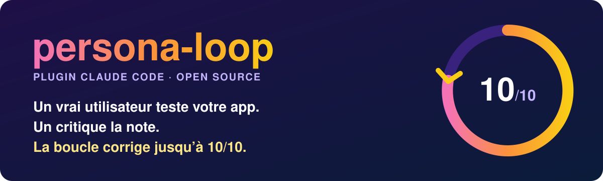
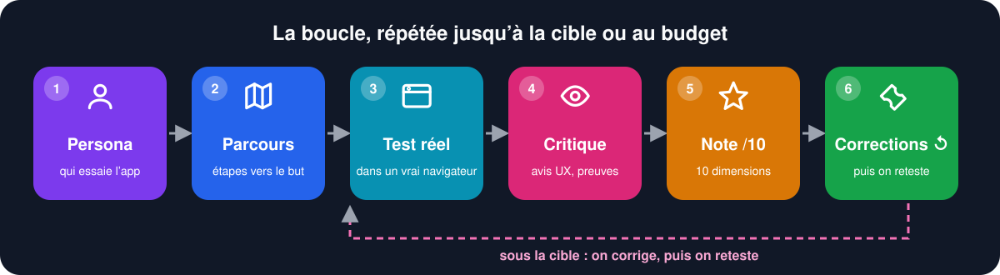
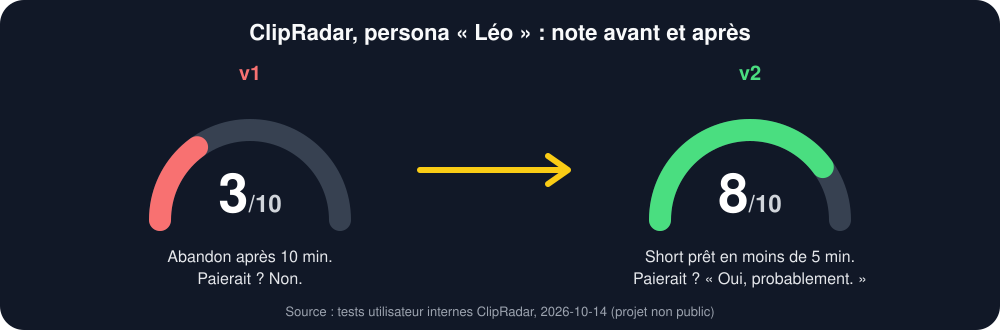
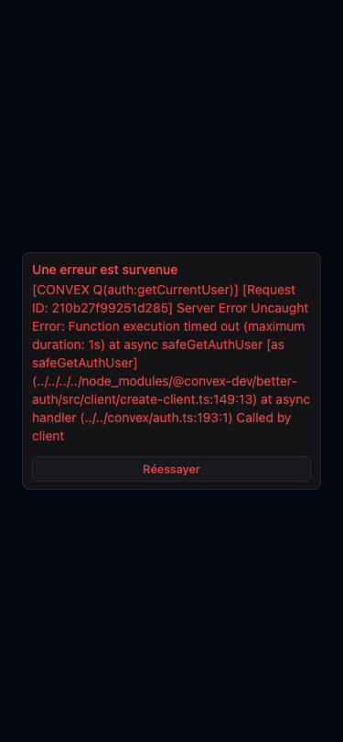
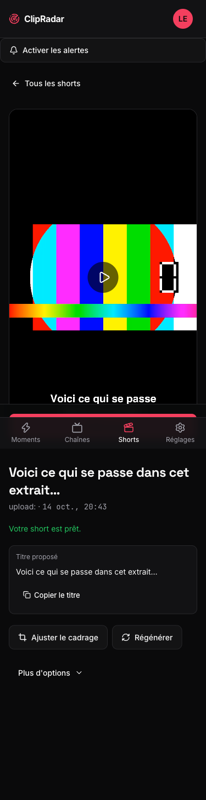
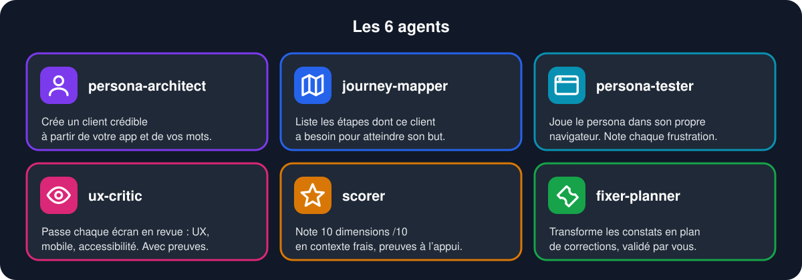

<div align="center">



[](LICENSE)
[](https://docs.claude.com/en/docs/claude-code/plugins)
[](https://github.com/microsoft/playwright-mcp)
[](#ce-que-vous-obtenez)

[English](README.md) · **Français**

</div>

## En 30 secondes

- persona-loop invente un client crédible pour votre app web et le fait utiliser l'app dans un vrai navigateur.
- Un critique exigeant relit le test et note 10 dimensions sur 10, chaque note avec une capture ou une requête en preuve.
- Il planifie les corrections, les applique si vous êtes d'accord, puis reteste jusqu'à la cible ou au budget.



## Une vraie histoire : Léo et ClipRadar

ClipRadar transforme des directs Twitch en shorts. C'est un projet interne, non public.
**Léo, 24 ans, clippeur freelance, zéro patience**, l'a testé deux fois.



| v1 : Léo abandonne à 10 min | v2 : short prêt en moins de 5 min |
|:---:|:---:|
|  |  |
| Déconnecté à chaque rechargement. Écran de crash avec stack trace. Email de confirmation jamais reçu. **3/10**, ne paierait pas. | Aucun crash, aucune déconnexion. Moment repéré en ~15 s, short créé en ~45 s. **8/10**, « oui, probablement » pour payer. |

persona-loop a **trouvé** 10 frustrations horodatées avec captures, les a **classées**, les corrections sont passées, et le même persona a **retesté**.
L'histoire complète : [`examples/clipradar-2026-10-14/STORY.md`](examples/clipradar-2026-10-14/STORY.md) (en anglais).

## Les 6 agents



## Installer en 2 minutes

Il vous faut [Claude Code](https://docs.claude.com/en/docs/claude-code). Ajoutez le navigateur du persona :

```bash
claude mcp add playwright npx @playwright/mcp@latest
```

Puis, dans Claude Code :

```text
/plugin marketplace add ohvignas/persona-loop
/plugin install persona-loop@persona-loop-marketplace
```

Lancez votre app, ouvrez Claude Code dans son dossier, et tapez :

```text
/persona-loop:persona-loop http://localhost:3000 --max-iterations 3
```

Il vous demande quel compte de test utiliser et s'il peut modifier le code. Juste un diagnostic ? Ajoutez `--no-fix`.

<details>
<summary>Toutes les commandes</summary>

| Commande | Rôle |
|---|---|
| `/persona-loop:persona-loop <url> [--persona] [--goal] [--max-iterations N] [--target 10] [--no-fix]` | La boucle complète |
| `/persona-loop:persona <url>` | Créer le persona seul |
| `/persona-loop:journey <url>` | Cartographier le parcours |
| `/persona-loop:test <url>` | Un test réel par le persona |
| `/persona-loop:critique <url>` | Critique UX |
| `/persona-loop:score` | Noter la dernière itération |
| `/persona-loop:report` | Bilan de toutes les itérations |

Copie locale : `/plugin marketplace add /chemin/vers/persona-loop`, ou `claude --plugin-dir /chemin/vers/persona-loop`.
</details>

## Ce que vous obtenez

Un dossier par passage, dans `docs/persona-loop/<date>/` :

```text
persona.md            qui teste, ce qu'il veut, sa patience
journey.md            les étapes et ce que « réussi » veut dire
iteration-1/
  test-report.md      chronologie, frustrations, « paierais-je ? »
  critique.md         constats UX-1..n, chacun avec sa preuve
  scores.md           10 dimensions /10
  iteration-report.md plan de corrections FIX-1..n
  screenshots/
```

Extrait réel de `scores.md` (ClipRadar, persona Kenzo, itération 1, [rapport complet](examples/clipradar-2026-10-14/)) :

| Dimension | Note | Preuve |
|---|:---:|---|
| Onboarding | 🟠 6 | valider avant que la page soit prête la recharge, aucune requête d'auth envoyée |
| Mobile | 🟠 6 | à 375 px, le bandeau cookies couvre le bouton d'inscription |
| Stabilité | 🟢 8 | 0 déconnexion sur 8 rechargements |

Les 10 dimensions : clarté de la promesse, onboarding, parcours principal, UI, retours UX, accessibilité, mobile, textes, stabilité, confiance. La note globale est la plus faible.

## FAQ

**C'est quoi, un persona ?** Le portrait précis d'un client : nom, métier, objectif, et combien de minutes il donne à votre app avant de partir.

**Il modifie mon code ?** Seulement si vous l'autorisez. Il montre le plan d'abord, demande avant toute action destructive et ne touche jamais à vos tests existants.

**Combien ça coûte ?** Une itération lance 4 à 5 agents et une session de navigateur. Commencez par `--max-iterations 1 --no-fix` pour mesurer sur votre app.

**Il atteint toujours 10/10 ?** Non. Il s'arrête au budget ou répond `BLOCKED` avec ce qui échoue. Il n'annonce jamais une note qu'il ne peut pas prouver.

**Limites ?** Apps web uniquement, Playwright MCP requis. Un persona modélise un utilisateur : utilisez-le avant les vrais entretiens, pas à leur place.

## Contribuer

Voir [CONTRIBUTING.md](CONTRIBUTING.md) et [CODE_OF_CONDUCT.md](CODE_OF_CONDUCT.md). Vérifiez avec `node scripts/validate.mjs .` et `claude plugin validate .`.

## Licence

[MIT](LICENSE) · ILLITH SAS
