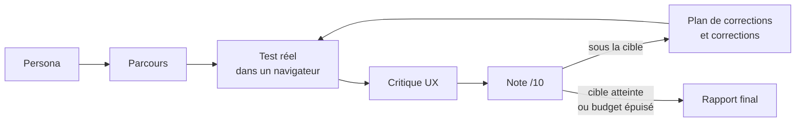
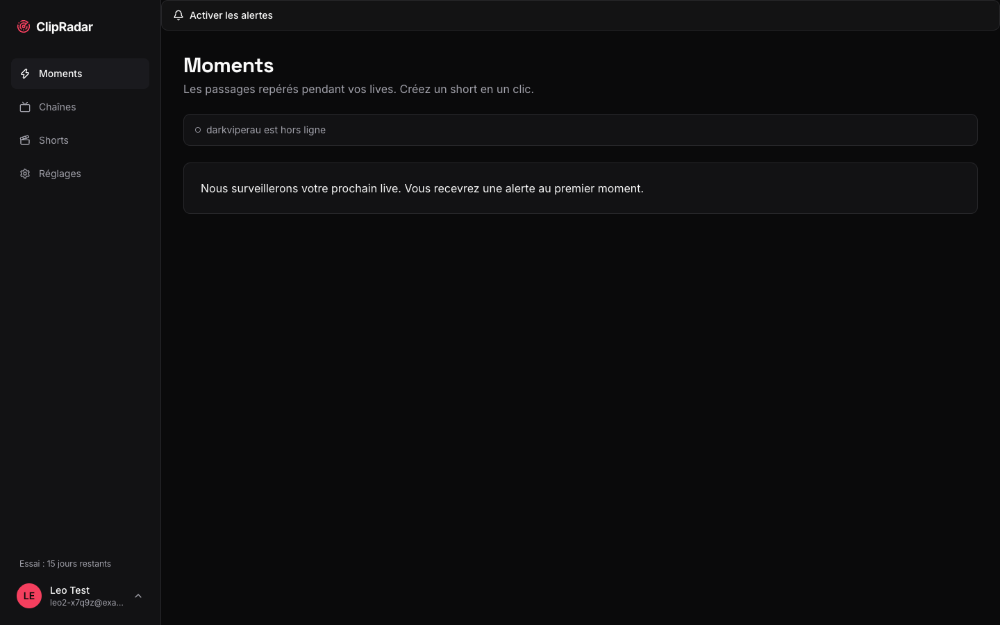

<div align="center">

# persona-loop

**Un vrai client imaginaire essaie votre app web pour de vrai, vous dit ce qui coince, et vous aide à corriger jusqu'à 10/10.**

[](LICENSE)
[](https://docs.claude.com/en/docs/claude-code/plugins)
[](.github/workflows/validate.yml)

[English](README.md) · Français

</div>

---

## Pourquoi

Les tests disent que le code tourne. Ils ne disent pas qu'une vraie personne abandonne au bout de 10 minutes.
persona-loop est un plugin [Claude Code](https://docs.claude.com/en/docs/claude-code) qui :

1. crée un **persona réaliste** à partir de votre app (qui il est, ce qu'il veut, sa patience) ;
2. dessine le **parcours** dont il a besoin ;
3. le fait **utiliser votre app pour de vrai** dans un navigateur ;
4. demande à un **critique UX exigeant** de juger ce qui s'est passé ;
5. **note** 10 dimensions sur 10, chaque note appuyée par une preuve ;
6. planifie les **corrections**, puis reteste.

## La boucle



## Résultat réel : ClipRadar

ClipRadar (un SaaS qui transforme des lives Twitch en shorts) est passé par cette boucle.

| | Avant | Après |
|---|---|---|
| Note du persona (« Léo », clippeur freelance) | **3/10**, abandon à 10 min, écran de crash avec stack trace | **8/10** après la refonte (source : rapport de test utilisateur interne de ClipRadar, non public) |
| Paierait-il 19/mois ? | Non | Oui, probablement |

| Avant : écran de crash | Après : moments, bureau | Après : short, mobile |
|---|---|---|
|  |  |  |

Seuls ces deux chiffres viennent du vrai projet. persona-loop n'invente jamais de chiffres.

## Installer en 2 minutes

Il vous faut [Claude Code](https://docs.claude.com/en/docs/claude-code) et le serveur MCP Playwright (le navigateur du persona) :

```bash
claude mcp add playwright npx @playwright/mcp@latest
```

Puis, dans Claude Code :

```text
/plugin marketplace add ohvignas/persona-loop
/plugin install persona-loop@persona-loop-marketplace
```

Pour essayer une copie locale :

```text
/plugin marketplace add /chemin/vers/persona-loop
/plugin install persona-loop@persona-loop-marketplace
```

ou lancez `claude --plugin-dir /chemin/vers/persona-loop`.

## Votre premier lancement

1. Démarrez votre app (par exemple sur `http://localhost:3000`).
2. Ouvrez Claude Code **dans le dossier de votre app**.
3. Tapez :
   ```text
   /persona-loop:persona-loop http://localhost:3000 --goal "créer un compte et obtenir mon premier résultat" --max-iterations 3
   ```
4. Répondez à ses questions (quel compte de test utiliser, a-t-il le droit de corriger le code).
5. Lisez les résultats dans `docs/persona-loop/<date>/`.

Vous voulez seulement un diagnostic, sans toucher au code ? Ajoutez `--no-fix`.

| Commande | Rôle |
|---|---|
| `/persona-loop:persona-loop <url> [--persona] [--goal] [--max-iterations N] [--target 10] [--no-fix]` | Toute la boucle |
| `/persona-loop:persona <url>` | Le persona seul |
| `/persona-loop:journey <url>` | Le parcours |
| `/persona-loop:test <url>` | Un test réel par le persona |
| `/persona-loop:critique <url>` | La critique UX |
| `/persona-loop:score` | Noter la dernière itération |
| `/persona-loop:report` | Synthèse de toutes les itérations |

Les commandes de plugin sont préfixées : la commande principale est `/persona-loop:persona-loop` (certaines versions de Claude Code acceptent aussi `/persona-loop` sans ambiguïté).

## Ce que vous obtenez

```text
docs/persona-loop/2026-10-14/
  persona.md         qui teste, ce qu'il veut, sa patience
  journey.md         étapes, signaux attendus, critères J-1..J-n
  iteration-1/
    test-report.md   chronologie horodatée, frustrations, mots incompris, note, « paierait-il ? »
    critique.md      constats UX-1..n avec preuves
    scores.md        10 dimensions /10, une preuve pour chacune
    iteration-report.md  plan FIX-1..n, décisions à prendre
    screenshots/
```

Vrai passage de la méthode de ce plugin sur ClipRadar (itération 1, 14/10/2026), persona Kenzo, streamer Twitch GTA RP : **moyenne 7,3/10, dimension la plus faible 6/10**, « paierait-il ? » peut-être. Rapport complet (compte de test masqué, 3 captures conservées) : [`examples/clipradar-2026-10-14/`](examples/clipradar-2026-10-14/). Extrait :

| # | Dimension | Note | Preuve |
|---|---|---|---|
| 2 | Onboarding | 6 | valider avant que la page soit prête la recharge en silence (`GET /sign-up?`, aucune requête d'auth) |
| 7 | Mobile | 6 | à 375 px, la bannière cookies cache le bouton d'inscription et avale le tap |
| 9 | Stabilité | 8 | 0 déconnexion sur 8 rechargements |

## Les 10 dimensions

Clarté de la promesse · Onboarding / temps jusqu'à la valeur · Parcours principal · UI visuelle · UX / feedback · Accessibilité · Mobile · Copywriting / i18n · Stabilité / erreurs · Confiance / légal.
10 = plus rien à corriger, 8 = défauts mineurs, 6 = un défaut majeur, 4 = un bloquant. Note globale = la dimension la plus faible.

## FAQ débutant

**C'est quoi, un persona ?** Le portrait précis et crédible d'un client : prénom, métier, ce qu'il veut accomplir, le temps qu'il accorde à votre app avant de partir. Tester « en tant que Kenzo, streamer pressé » trouve des problèmes qu'on rate « en tant que développeur ».

**Combien ça coûte en tokens ?** Ça dépend de votre app et du nombre d'itérations. Une itération lance 4 à 5 agents et une vraie session de navigateur : bien plus qu'un message de chat. Commencez par `--max-iterations 1 --no-fix` pour mesurer sur votre app. Nous ne publions pas d'estimation non mesurée.

**Est-ce que ça modifie mon code ?** Seulement si vous le permettez. Sans `--no-fix`, il montre d'abord le plan, demande avant toute action destructive ou externe, ne touche jamais à vos tests existants et suit les règles de votre projet (CLAUDE.md).

**Ça marche sur n'importe quel site ?** Toute app web joignable depuis votre machine. Pour un site qui n'est pas le vôtre, il demande d'abord. Il ne paie jamais, n'envoie pas de vrais messages, n'utilise pas de vrais mots de passe.

**Ça atteint vraiment 10/10 ?** Pas toujours. Il s'arrête au budget d'itérations, ou dit `BLOQUÉ` avec ce qui échoue. Il n'affirme jamais une note qu'il ne peut pas prouver.

## Limites

- Nécessite le serveur MCP Playwright ; web uniquement (pas encore d'apps mobiles natives).
- Chaque testeur doit avoir son propre contexte navigateur. Navigateur partagé avec un autre agent = résultats faux ; le testeur s'arrête.
- Les scores Lighthouse n'apparaissent que si la CLI Lighthouse est disponible.
- Un persona est un modèle, pas un vrai utilisateur : à utiliser avant les vrais entretiens, pas à leur place.

## Contribuer

Voir [CONTRIBUTING.md](CONTRIBUTING.md) et [CODE_OF_CONDUCT.md](CODE_OF_CONDUCT.md). Validez avec `node scripts/validate.mjs .` et `claude plugin validate .`.

## Licence

[MIT](LICENSE)
