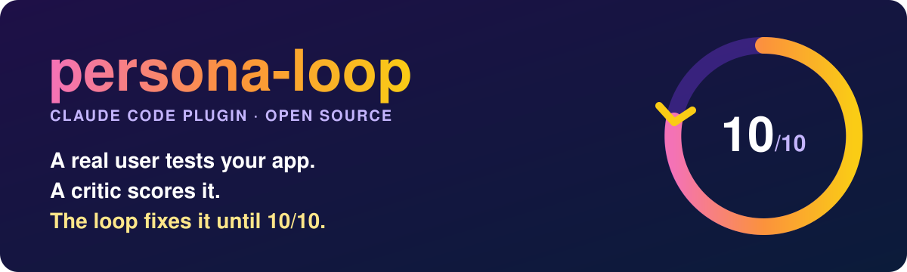
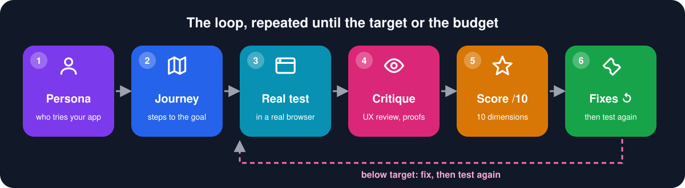
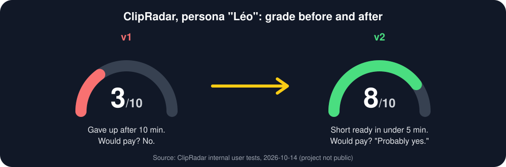
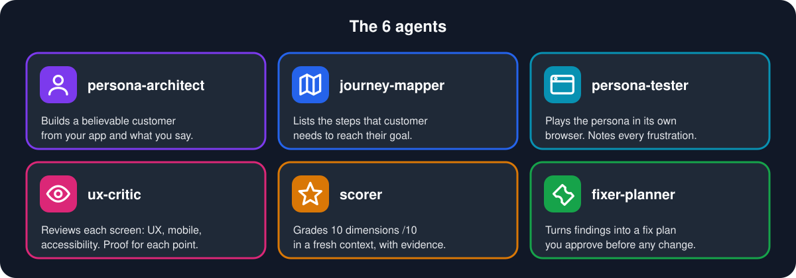

<div align="center">



[](LICENSE)
[](https://docs.claude.com/en/docs/claude-code/plugins)
[](https://github.com/microsoft/playwright-mcp)
[](#what-you-get)

**English** · [Français](README.fr.md)

</div>

## In 30 seconds

- persona-loop invents a believable customer for your web app and makes them use it in a real browser.
- A strict critic reviews what happened and grades 10 dimensions out of 10, with a screenshot or a request as proof.
- It plans the fixes, applies them if you agree, and tests again until the target or the budget.



## A real story: Léo and ClipRadar

ClipRadar turns Twitch lives into shorts. It is an internal project, not public.
**Léo, 24, freelance clipper, zero patience**, tried it twice.



| v1: Léo quits at 10 min | v2: short ready in under 5 min |
|:---:|:---:|
|  |  |
| Logged out on every reload. Crash screen with a stack trace. Confirmation email that never came. **3/10**, would not pay. | No crash, no logout. Moment found in ~15 s, short made in ~45 s. **8/10**, would probably pay. |

persona-loop **found** 10 frustrations with timestamps and screenshots, **ranked** them, the fixes went in, and the same persona **tested again**.
Full story: [`examples/clipradar-2026-10-14/STORY.md`](examples/clipradar-2026-10-14/STORY.md).

## The 6 agents



## Install in 2 minutes

You need [Claude Code](https://docs.claude.com/en/docs/claude-code). Add the browser the persona uses:

```bash
claude mcp add playwright npx @playwright/mcp@latest
```

Then, inside Claude Code:

```text
/plugin marketplace add ohvignas/persona-loop
/plugin install persona-loop@persona-loop-marketplace
```

Start your app, open Claude Code in its folder, and run:

```text
/persona-loop:persona-loop http://localhost:3000 --max-iterations 3
```

It asks which test account it may use and whether it may change code. Want a diagnosis only? Add `--no-fix`.

<details>
<summary>All commands</summary>

| Command | What it does |
|---|---|
| `/persona-loop:persona-loop <url> [--persona] [--goal] [--max-iterations N] [--target 10] [--no-fix]` | The whole loop |
| `/persona-loop:persona <url>` | Build the persona only |
| `/persona-loop:journey <url>` | Map the journey |
| `/persona-loop:test <url>` | One real test by the persona |
| `/persona-loop:critique <url>` | UX critique |
| `/persona-loop:score` | Score the latest iteration |
| `/persona-loop:report` | Summary of all iterations |

Local copy: `/plugin marketplace add /path/to/persona-loop`, or `claude --plugin-dir /path/to/persona-loop`.
</details>

## What you get

One folder per run, in `docs/persona-loop/<date>/`:

```text
persona.md            who tests, what they want, how patient they are
journey.md            the steps and what "success" looks like
iteration-1/
  test-report.md      timeline, frustrations, "would I pay?"
  critique.md         findings UX-1..n, each with proof
  scores.md           10 dimensions /10
  iteration-report.md fix plan FIX-1..n
  screenshots/
```

A real `scores.md` excerpt (ClipRadar, persona Kenzo, iteration 1, [full report](examples/clipradar-2026-10-14/)):

| Dimension | Score | Proof |
|---|:---:|---|
| Onboarding | 🟠 6 | submitting before the page is ready reloads it, no auth request sent |
| Mobile | 🟠 6 | at 375 px the cookie banner covers the sign-up button |
| Stability | 🟢 8 | 0 logouts over 8 reloads |

The 10 dimensions: promise clarity, onboarding, main journey, visual UI, UX feedback, accessibility, mobile, copywriting, stability, trust. The overall score is the weakest one.

## FAQ

**What is a persona?** A precise portrait of one customer: name, job, goal, and how many minutes they give your app before leaving.

**Does it change my code?** Only if you allow it. It shows the plan first, asks before anything destructive, and never edits your existing tests.

**How much does it cost?** One iteration runs 4 to 5 agents and a browser session. Start with `--max-iterations 1 --no-fix` to measure it on your app.

**Will it reach 10/10?** Not always. It stops at the budget or reports `BLOCKED` with what fails. It never claims a score it cannot prove.

**Limits?** Web apps only, Playwright MCP required. A persona is a model of a user: use it before real interviews, not instead of them.

## Contributing

See [CONTRIBUTING.md](CONTRIBUTING.md) and [CODE_OF_CONDUCT.md](CODE_OF_CONDUCT.md). Check your changes with `node scripts/validate.mjs .` and `claude plugin validate .`.

## License

[MIT](LICENSE) · ILLITH SAS
