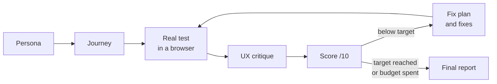

<div align="center">

# persona-loop

**Let a realistic customer try your web app for real, tell you what hurts, and help you fix it until it scores 10/10.**

[](LICENSE)
[](https://docs.claude.com/en/docs/claude-code/plugins)
[](.github/workflows/validate.yml)

English · [Français](README.fr.md)

</div>

---

## Why

Tests tell you the code runs. They do not tell you that a real person gives up after 10 minutes.
persona-loop is a [Claude Code](https://docs.claude.com/en/docs/claude-code) plugin that:

1. invents a **realistic persona** from your app (who they are, what they want, how patient they are),
2. maps the **journey** they need,
3. makes them **use your app for real** in a browser,
4. asks a **demanding UX critic** to review what happened,
5. **scores** 10 dimensions out of 10, every grade backed by proof,
6. plans the **fixes**, then tests again.

## The loop



## Real result: ClipRadar

ClipRadar (a SaaS that turns Twitch lives into shorts) went through this loop.

| | Before | After |
|---|---|---|
| Persona grade ("Léo", freelance clipper) | **3/10**, gave up after 10 min, crash screen with stack trace | **8/10** after the redesign (source: ClipRadar internal user-test report, not public) |
| Would they pay 19/month? | No | Yes, probably |

| Before: crash screen | After: moments, desktop | After: short, mobile |
|---|---|---|
|  |  |  |

Only these two numbers come from the real project. persona-loop never invents numbers.

## Install in 2 minutes

You need [Claude Code](https://docs.claude.com/en/docs/claude-code) and the Playwright MCP server (the browser the persona uses):

```bash
claude mcp add playwright npx @playwright/mcp@latest
```

Then, inside Claude Code:

```text
/plugin marketplace add ohvignas/persona-loop
/plugin install persona-loop@persona-loop-marketplace
```

Trying a local copy instead:

```text
/plugin marketplace add /path/to/persona-loop
/plugin install persona-loop@persona-loop-marketplace
```

or start Claude Code with `claude --plugin-dir /path/to/persona-loop`.

## Your first run

1. Start your app (for example on `http://localhost:3000`).
2. Open Claude Code **in your app's folder**.
3. Type:
   ```text
   /persona-loop:persona-loop http://localhost:3000 --goal "create an account and get my first result" --max-iterations 3
   ```
4. Answer the questions it asks (which test account it may use, whether it may fix code).
5. Read the results in `docs/persona-loop/<date>/`.

Just want a diagnosis, no code change? Add `--no-fix`.

| Command | What it does |
|---|---|
| `/persona-loop:persona-loop <url> [--persona] [--goal] [--max-iterations N] [--target 10] [--no-fix]` | The whole loop |
| `/persona-loop:persona <url>` | Build the persona only |
| `/persona-loop:journey <url>` | Map the journey |
| `/persona-loop:test <url>` | One real test by the persona |
| `/persona-loop:critique <url>` | UX critique |
| `/persona-loop:score` | Score the latest iteration |
| `/persona-loop:report` | Summary of all iterations |

Plugin commands are namespaced: the main command is `/persona-loop:persona-loop` (some Claude Code versions also accept `/persona-loop` when it is unambiguous).

## What you get

```text
docs/persona-loop/2026-10-14/
  persona.md         who tests, what they want, their patience
  journey.md         steps, expected signals, criteria J-1..J-n
  iteration-1/
    test-report.md   timestamped timeline, frustrations, misunderstood words, grade, "would I pay?"
    critique.md      findings UX-1..n with evidence
    scores.md        10 dimensions /10, evidence for each
    iteration-report.md  fix plan FIX-1..n, owner decisions
    screenshots/
```

Real run of this plugin's method on ClipRadar (iteration 1, 2026-10-14), persona Kenzo, Twitch GTA RP streamer: **average 7.3/10, weakest dimension 6/10**, "would I pay?" maybe. Full report (in French, test account redacted, 3 of the screenshots kept): [`examples/clipradar-2026-10-14/`](examples/clipradar-2026-10-14/). Excerpt:

| # | Dimension | Score | Evidence |
|---|---|---|---|
| 2 | Onboarding | 6 | submitting before the page is ready silently reloads it (`GET /sign-up?`, no auth request) |
| 7 | Mobile | 6 | at 375 px the cookie banner covers the sign-up button and swallows the tap |
| 9 | Stability | 8 | 0 logouts over 8 reloads |

## The 10 dimensions

Promise clarity · Onboarding / time to value · Main journey · Visual UI · UX / feedback · Accessibility · Mobile · Copywriting / i18n · Stability / errors · Trust / legal.
10 = nothing left to fix, 8 = minor issues only, 6 = a major issue, 4 = a blocker. Overall score = the weakest dimension.

## Beginner FAQ

**What is a persona?** A precise, believable portrait of one customer: name, job, what they want to get done, how much time they will give your app before leaving. Testing "as Kenzo, a streamer with 5 minutes" finds problems that "as a developer" misses.

**How much does it cost in tokens?** It depends on your app and the number of iterations. One iteration runs 4 to 5 agents and a real browser session, so it is much more than a chat message. Start with `--max-iterations 1 --no-fix` to see the cost on your own app. We do not publish an estimate we have not measured.

**Does it modify my code?** Only if you let it. Without `--no-fix`, it shows the fix plan first, asks before anything destructive or external, never edits your existing tests, and follows your project rules (CLAUDE.md).

**Can it test any website?** Any web app reachable from your machine. For a site you do not own, it asks first. It never pays, sends real messages, or uses real passwords.

**Will it really reach 10/10?** Sometimes not. It stops at the iteration budget, or says `BLOCKED` with what fails. It will never claim a score it cannot prove.

## Limits

- Needs the Playwright MCP server; web only (no native mobile apps yet).
- Each tester needs its own browser context. If your browser is shared with another agent, results are wrong; the tester stops instead.
- Lighthouse scores appear only if the Lighthouse CLI is available.
- A persona is a model, not a real user. Use it before, not instead of, real interviews.

## Contributing

See [CONTRIBUTING.md](CONTRIBUTING.md) and [CODE_OF_CONDUCT.md](CODE_OF_CONDUCT.md). Validate with `node scripts/validate.mjs .` and `claude plugin validate .`.

## License

[MIT](LICENSE)
